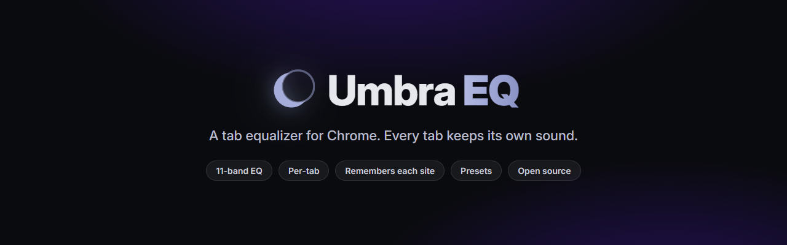
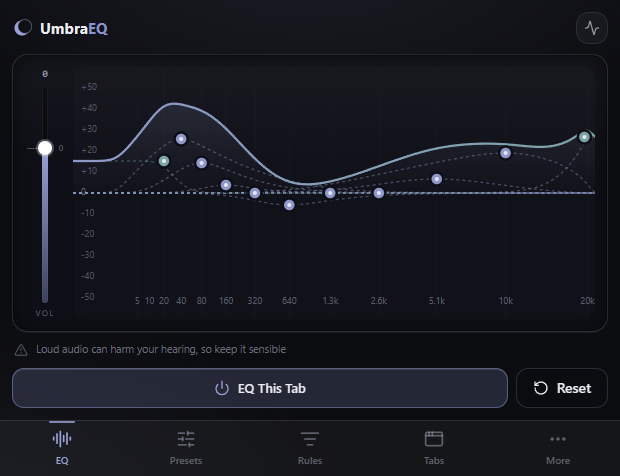
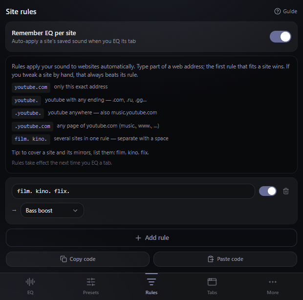

<p align="center">
  <a href="https://github.com/skyjacc/Umbra/releases/latest"></a>
</p>

<h1 align="center">Umbra EQ</h1>

<p align="center">
  <b>Параметрический эквалайзер и усиление баса для каждой вкладки — Chrome, Edge и Opera</b><br>
  11 полос &middot; один общий звук &middot; правила для сайтов &middot; локальная обработка звука
</p>

<p align="center">
  <a href="https://chromewebstore.google.com/detail/plkncppcgglcjdkmcdeajhbfccbnnoee?utm_source=github&amp;utm_medium=referral&amp;utm_campaign=release_2_5_0"></a>
  <a href="https://chromewebstore.google.com/detail/plkncppcgglcjdkmcdeajhbfccbnnoee?utm_source=github&amp;utm_medium=referral&amp;utm_campaign=release_2_5_0"></a>
  <a href="LICENSE"></a>
  <a href="https://github.com/skyjacc/Umbra/actions/workflows/build.yml"></a>
  
  
</p>

<p align="center">
  <a href="https://chromewebstore.google.com/detail/plkncppcgglcjdkmcdeajhbfccbnnoee?utm_source=github&amp;utm_medium=referral&amp;utm_campaign=release_2_5_0"></a>
  &nbsp;
  <a href="README.md"></a>
</p>

<p align="center">
  
  &nbsp;
  
</p>

## Зачем нужен Umbra EQ

Слабый бас на ноутбучных динамиках, одно видео сведено слишком тихо, другое — слишком резко. Umbra позволяет настроить звук захваченной вкладки во время воспроизведения. Аудио обрабатывается на вашем компьютере. Один профиль для обрабатываемых вкладок или свой звук отдельным сайтам через правила.

## Что умеет

- **Параметрический EQ на 11 полос** — тяни кривую и поднимай или срезай любую частоту вживую.
  Или введи числа: частоту и усиление каждой полосы, а для пиковых фильтров — ширину (Q).
- **Профили для сайтов** — оставь общий профиль для обрабатываемых вкладок, а отдельным сайтам дай свой. У вкладки с музыкой
  может быть одна кривая, у вкладки с видео другая, а общий профиль останется нетронутым. Правила
  сопоставляются по шаблону адреса, побеждает первое совпадение, и у каждой вкладки своя цепочка.
- **Сохранить для этого сайта** — превратить звук, который слышишь, в правило для текущего сайта,
  не меняя того, как звучит всё остальное.
- **Вернуть** — откатить звук к тому, каким он был при открытии Umbra. Не на шаг назад, а целиком.
- **Bypass** — послушать вкладку без обработки, пока кривая остаётся редактируемой, и сравнить.
  Пока bypass включён, ничего не сохраняется.
- **Пресеты, от которых можно оттолкнуться** — Bass Boost / Vocal / Movie / Warm и свои. Сдвинь
  полосу, и шапка продолжит писать *На основе Vocal*: подправленный пресет не превращается в
  безымянную кривую.
- **Авто-громкость** *(по умолчанию выключена)* — оценивает компенсацию по настройкам EQ,
  не меняя сохранённую громкость. Громкость самой записи она не измеряет и разные видео автоматически не выравнивает.
- **Пик-метр выхода** — показывает общий стереовыход всех захваченных вкладок после ограничителя.
  Спектр при этом относится к выбранной вкладке.
- **Захват звука вкладки** — обрабатывает звук, который Chrome предоставляет для захвата.
  Защищённые материалы и внутренние страницы браузера могут не поддерживать захват.
- **Бас, громкость выше 100%, ограничитель** — диапазон громкости от −50 до +20 дБ. Общий
  ограничитель с задержкой 5 мс ограничивает пики отсчётов до −1 dBFS; это не true-peak limiter,
  и он не исправляет искажения, уже присутствующие в записи.
- **Живой спектр, гид по полосам, полноэкранный редактор.**
- **Дружелюбен к клавиатуре и скринридерам**, RU/EN, четыре темы и свой цвет акцента. Без
  аккаунта Umbra и аналитики. Пресеты и правила могут использовать Chrome Sync.

> Сохранён исходный интерфейс с точечными улучшениями: [описание и скриншоты](docs/DESIGN.md).

## Как пользоваться

1. Включи звук на вкладке, нажми иконку Umbra EQ, затем **Включить на вкладке**.
2. Тяни точку на кривой: влево-вправо — частота, вверх-вниз — усиление или срез. Регулятор слева —
   общая громкость.
3. Удобнее с клавиатуры? Наведи фокус на точку и жми стрелки — **Shift** для крупного шага,
   **Alt** для мелкого. Или перейди табом в строку под графиком и введи частоту, усиление и Q.
4. **Сохранить для {сайт}** оставит этот звук за сайтом, **⟲** вернёт как было, а **Bypass** даст
   послушать вкладку без обработки.

Встроенный гид «**Как пользоваться**» (вкладка **Ещё**) проходит по всему — на русском или
английском.

<!-- НУЖЕН СКРИНШОТ — docs/screenshot-precision.png (общий с английским README)
     Строка полос под графиком с вводимым значением и шапка «На основе Vocal».
<p align="center"></p>
-->

<!-- НУЖЕН СКРИНШОТ — docs/screenshot-bypass.png (общий с английским README)
     Bypass включён: сплошная линия 0 дБ, приглушённая но живая кривая, значок и кнопка ⟲.
<p align="center"></p>
-->

## Установка

**[Установить из Chrome Web Store](https://chromewebstore.google.com/detail/plkncppcgglcjdkmcdeajhbfccbnnoee?utm_source=github&utm_medium=referral&utm_campaign=release_2_5_0)** — в один клик, с авто-обновлением.

На Edge или Opera, либо чтобы запустить свою сборку, загрузи как распакованное (около минуты):

1. Скачай последний `umbra-eq-<версия>.zip` со [страницы релизов](https://github.com/skyjacc/Umbra/releases/latest) и распакуй (или собери из исходников ниже).
2. Открой `chrome://extensions` (или `edge://`, `opera://`) и включи **Режим разработчика**.
3. **Загрузить распакованное** → выбери распакованную папку, содержащую `manifest.json`. После сборки из исходников это папка `dist/`. Chrome 116+.

> [!NOTE]
> Иконка не реагирует? Выбери папку с **`manifest.json`**: распакованный релиз или **`dist/`** после сборки из исходников, на Chrome 116+ — движку нужен offscreen-document API.

## Поддержка браузеров

| Браузер | Статус | Примечания |
| ------- | ------ | ---------- |
| **Chrome** | Поддерживается | Chrome 116+ (offscreen document + захват вкладки) |
| **Edge** | Поддерживается | Chromium, тот же пакет |
| **Opera** | Поддерживается | Chromium, тот же пакет |
| **Firefox** | В планах | Нужен отдельный движок на content-script (в Firefox нет `tabCapture`/`offscreen`). См. [`FIREFOX_PORT.md`](FIREFOX_PORT.md). |

## Сборка из исходников

<details>
<summary><b>Для разработчиков</b></summary>

Попап — приложение на React и TypeScript, собранное Vite и [CRXJS](https://crxjs.dev). Аудиодвижок (service worker + offscreen-документ Web Audio) остаётся на чистом JS. Используй Node 24 LTS; ни ключей, ни переменных окружения, ни сервисов настраивать не надо.

```bash
npm ci
npm run build      # → dist/  (загружаемое, чистое по CSP расширение MV3)
npm run dev        # dev-сборка с HMR
npm test           # модульные и DOM-тесты Vitest
npm run typecheck  # tsc, также в CI
```

Затем загрузи папку **`dist`** как распакованное расширение (см. [Установка](#установка)). Для zip магазина:

```bash
npm run build
powershell -ExecutionPolicy Bypass -File build-zip.ps1
# → release/umbra-eq-<версия>.zip
```

Тот же zip принимают Chrome Web Store, Edge Add-ons и Opera.

> Цикл разработки: `npm run build` → **Reload** на карточке расширения → Ctrl+R попапа.
> После `vite dev` удали `node_modules/.vite` и `dist` перед настоящей сборкой, иначе `dist/` останется dev-заглушкой.

</details>

## Как это устроено

Manifest V3. **Попап** (React + TypeScript) — источник истины: вычисляет звук каждой вкладки (правило → общий профиль → плоский) и отправляет полосы движку. **Движок — на чистом JS**: service worker владеет offscreen-документом и выдаёт id захвата вкладок; offscreen держит цепочку из 11 biquad-фильтров на вкладку с плавным изменением параметров, затем сводит вкладки через общий AudioWorklet-ограничитель. Service worker подставляет сохранённые настройки при запуске захвата без попапа. Математика аудио/пресетов/правил — в `src/lib` (покрыта тестами); строгий CSP, без удалённого кода и `eval`.

Работаешь над Umbra? Начни с [`CONTRIBUTING.md`](CONTRIBUTING.md) — установка, цикл разработки и что требуют тесты. [`PROJECT.md`](PROJECT.md) — архитектурный справочник, [`DEPLOY.md`](DEPLOY.md) — релизный чек-лист.

Готовые тексты для магазина на русском и английском — в [`docs/store/README.md`](docs/store/README.md).

## Чем Umbra EQ отличается

Umbra объединяет три практические возможности:

- **Параметрическое управление.** У каждого из 11 biquad-фильтров можно менять частоту и усиление,
  у пиковых фильтров — ещё и ширину (Q).
- **Настройки по вкладкам.** Движок на `tabCapture` даёт каждой захваченной вкладке свою цепочку
  фильтров, поэтому музыкальная и видеовкладка могут звучать по-разному одновременно.
  Доступность захвата зависит от браузера и источника звука.
- **Локальная обработка звука и открытый код.** Без аккаунта Umbra, рекламы, аналитики и собственных сетевых запросов; MIT,
  всё можно проверить. Пресеты и правила могут использовать Chrome Sync; аудио обрабатывается локально.

## Частые вопросы

**Можно использовать Umbra как эквалайзер для YouTube или Spotify?** Umbra обрабатывает звук вкладки, если Chrome разрешает его захват. Совместимость зависит от плеера, версии браузера и защищённого контента; работа на каждом сайте и потоке не гарантируется. Включи звук в обычной веб-вкладке и нажми **Включить на вкладке**, чтобы проверить свой источник.

**Почему Chrome пишет, что вкладкой делятся?** Umbra берёт звук вкладки через API захвата — тот же механизм, что и демонстрация экрана, поэтому Chrome показывает свой индикатор. **Только звук**: поток запрашивается без видео. Umbra не захватывает кадры или скриншоты и не читает текст DOM или HTML страницы. Разрешение `tabCapture` в Chrome покрывает звук и видео вместе — иметь его не значит использовать для видео. Индикатор ставит сам браузер, расширение отключить его не может — и это правильно: ты всегда знаешь, когда вкладку захватывают. Пропадает после «Стоп».

**Перестал работать полный экран, пока включён эквалайзер. Почему?** Chrome может ограничивать полноэкранный режим во время захвата вкладки. Поведение зависит от браузера и плеера. Попробуй перейти в полный экран до включения Umbra либо остановить захват и заново открыть полный экран. Сочетание клавиш в `chrome://extensions/shortcuts` позволяет переключать Umbra без открытия попапа.

## Приватность

Звук остаётся на устройстве: Umbra не записывает и не отправляет его, не использует аналитику и серверы. Общий EQ и настройки интерфейса хранятся локально. Сохранённые пресеты и правила сайтов используют `chrome.storage.sync`: если синхронизация браузера включена, Chrome переносит эти настройки через твой Google-аккаунт. Подробности — в [`PRIVACY.md`](PRIVACY.md).

## Стек

| Слой | Технология |
| ---- | ---------- |
| Оболочка | Manifest V3 — service worker + offscreen-документ |
| Аудио | Web Audio API — 11 biquad-фильтров на вкладку + ограничитель |
| Попап | React 18, TypeScript |
| Сборка | Vite + CRXJS |
| UI | Tailwind CSS, shadcn/ui, иконки lucide |
| Тесты | Модульные/DOM-тесты Vitest + проверки аудио и UI в Chromium |
| CI/CD | GitHub Actions — собирает zip `dist/` на push, PR и тегах `v*` |

## Звёзды

Если Umbra починила твой звук — звезда помогает другим её найти.

<p align="center">
  <a href="https://github.com/skyjacc/Umbra/stargazers"></a>
  &nbsp;
  <a href="https://github.com/skyjacc/Umbra/releases"></a>
</p>

<a href="https://www.star-history.com/?repos=skyjacc%2FUmbra&type=date&legend=top-left">
 <picture>
   <source media="(prefers-color-scheme: dark)" srcset="https://api.star-history.com/chart?repos=skyjacc/Umbra&type=date&theme=dark&legend=top-left&sealed_token=5nsh_UHuzblZshtMf4C7j-zWnbA-LWyY6-LLQIzwh1MXehy-MxC_4vmIVqEk8ndH6zdj1JQ-kukR9mEB_843GXROAtzjeqD8ixp7dm939x0g3KxKxIeYps8NhWb8CWkyKJ1fnLStM4FTiU52ng2gk-dTKEzBCNWqRQtuvRDUpWtioYV4eFKxRwXAVMTM" />
   <source media="(prefers-color-scheme: light)" srcset="https://api.star-history.com/chart?repos=skyjacc/Umbra&type=date&legend=top-left&sealed_token=5nsh_UHuzblZshtMf4C7j-zWnbA-LWyY6-LLQIzwh1MXehy-MxC_4vmIVqEk8ndH6zdj1JQ-kukR9mEB_843GXROAtzjeqD8ixp7dm939x0g3KxKxIeYps8NhWb8CWkyKJ1fnLStM4FTiU52ng2gk-dTKEzBCNWqRQtuvRDUpWtioYV4eFKxRwXAVMTM" />
   
 </picture>
</a>

## Обратная связь

| | |
| --- | --- |
| Предложить идею | [Открыть обсуждение](https://github.com/skyjacc/Umbra/discussions) |
| Что-то сломалось? | [Создать issue](https://github.com/skyjacc/Umbra/issues/new) |
| Нравится? | [Поставьте звезду](https://github.com/skyjacc/Umbra/stargazers) |

## Поддержать Umbra

Umbra EQ бесплатна, и бесплатно — это не пробный период: все возможности уже в расширении и там и
останутся. Если она заслужила кофе:

<p align="center">
  <a href="https://ko-fi.com/oblako"></a>
  &nbsp;
  <a href="https://github.com/sponsors/skyjacc"></a>
</p>

## Участие в разработке

Issues и pull request'ы приветствуются — см. [`CONTRIBUTING.md`](CONTRIBUTING.md).

## Авторство и лицензии

- Код приложения: **MIT** ([`LICENSE`](LICENSE)).
- Шрифты: **Inter** и **Geist Mono** под SIL Open Font License 1.1.
- UI: **React**, **Tailwind CSS**, **shadcn/ui** (MIT), иконки **lucide-react** (ISC). Полный список: [`THIRD-PARTY-NOTICES.md`](THIRD-PARTY-NOTICES.md).

Umbra EQ — независимый аудиоинструмент, не связанный с Netflix, Spotify, YouTube, Google или сайтами, звук которых обрабатывает, и не одобренный ими. Все товарные знаки принадлежат их владельцам.
