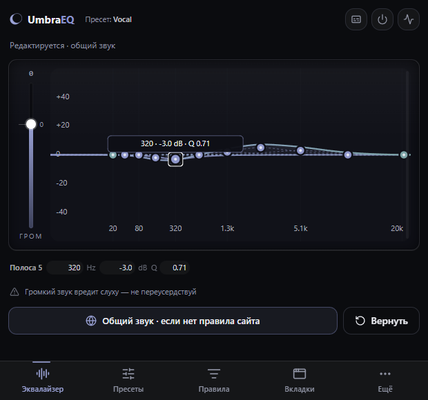
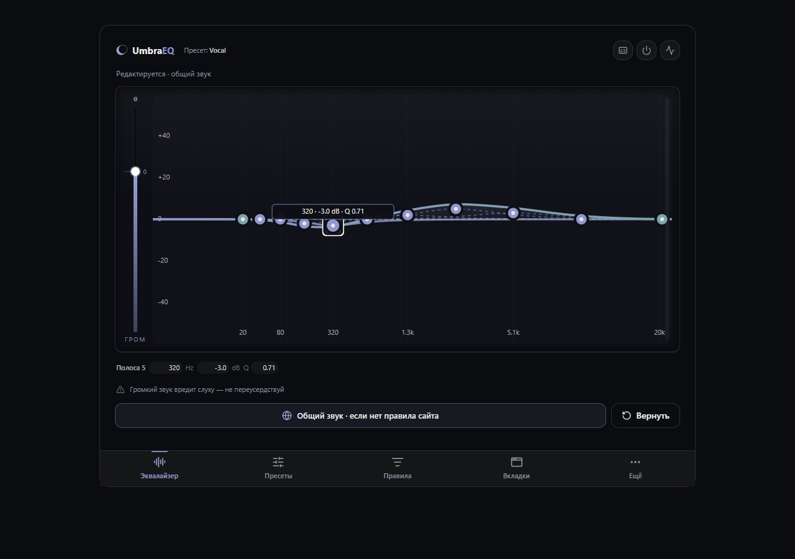

# Umbra: original interface, targeted polish

Updated 8 November 2026. The original design is the current direction. The sidebar
redesign and subsequent A/B prototypes are withdrawn from the application.

## Preserve

Umbra remains a compact audio instrument: a crescent mark, cool dark surfaces,
lavender bell filters and teal shelves, visible round band handles, a master fader
on the left, precise fields below the graph and navigation along the bottom.

The popup is **620 × 580 px**. Long lists scroll inside `main`, keeping navigation
reachable. The full-window editor retains the original centered frame, up to
960 px wide. The graph uses the full `0 0 524 252` viewBox and maps pointer movement
to the rendered size; editing remains correct after resizing.

## Improve

- Small text uses more consistent sizes; section gaps follow a regular rhythm.
- Hide/delete preset buttons meet the 24 px target baseline.
- Keyboard focus has a visible ring; menus retain keyboard control and focus return.
- The guide traps focus and temporarily makes the background inert.
- Reduced-motion preferences stop interface transitions and decorative motion.
- Selected bands remain highlighted when editing their exact values. Shelf Q stays
  unavailable because Web Audio shelf filters do not use it.
- Malformed saved hidden-preset preferences cannot crash the interface.
- Storage read failures have a persistent explanation and a retry action, while
  editing stays paused to protect the saved sound.
- Onboarding keeps its original composition, with complete EN/RU labels, readable
  privacy copy, narrow-screen fixes and a static real Vocal response.

The changes use **Unslop by Damir Sokolovsky**
([@heydamir](https://x.com/heydamir), [source](https://github.com/heydamir/unslop),
[CC BY 4.0](https://creativecommons.org/licenses/by/4.0/)) in polish mode, plus
`better-accessibility` for keyboard, focus and control semantics. The existing
brand and layout take precedence over generic template rules.

## Current interface

The popup screenshot is a CSS layout harness of the real built extension at
620 × 580, not a native toolbar capture session.

## Validation boundaries

Browser checks cover all five screens, responsive graph editing, preset recovery,
long names, menu focus, EN/RU, fixed popup geometry and persistent navigation.
Automated axe checks report no violations on those screens or the rule listbox.
The onboarding was checked at 1440/390/320 px. Keyboard regressions cover the
fader, listbox and guide isolation.

This is not full screen-reader certification. A release smoke check exercised native
`tabCapture` on two local audio tabs through Chromium's extension-action trigger.
Listening on actual sites and native toolbar usability remain separate manual checks.
Backend review uses deterministic worker/hook tests; DSP checks use native Web Audio.
See [release validation](store/validation-2.5.0.md).
